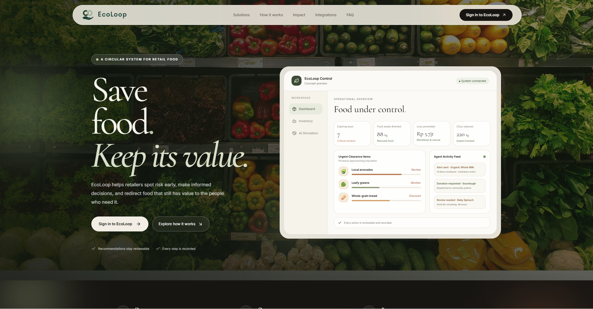
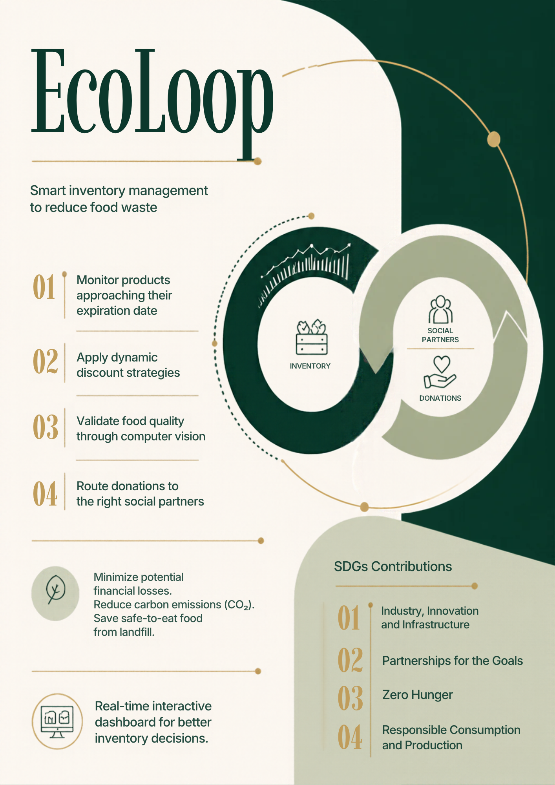

<div align="center">
  
  <h1 style="color:#0b3b2e">Save food. Keep its value.</h1>
  <p><strong>Smart inventory management to reduce food waste.</strong></p>
  <p>EcoLoop helps retail teams spot food nearing its expiration date, review recommendations, and route eligible products toward discounts or donations.</p>
  <p>
    <a href="https://app.ecolooppartner.my.id/">🔴 Live platform</a> &nbsp;·&nbsp;
    <a href="https://github.com/Relyzn119/ecoloop">💻 Source code</a>
  </p>
  <p>
    
    
    
    
    
  </p>
</div>

---

## Landing page

<div align="center">
  
  <br><sub>The EcoLoop landing page brings together food rescue, inventory visibility, and reviewable actions.</sub>
</div>

## About EcoLoop

EcoLoop is a web platform that helps retailers manage products and inventory batches by stock quantity and expiration date. Teams can review at-risk products, consider markdowns, and connect eligible surplus food with donation partners. Recommendations and follow-up actions are recorded so decisions can be reviewed.

<div align="center">
  
  <br><sub>EcoLoop poster</sub>
</div>

## Account types

EcoLoop has four account categories. The public registration page offers the three partner types; the system administrator account is provisioned internally and is not available for public self-registration.

| Account type | Purpose | Registration |
|:--|:--|:--|
| **Foundation / Charity** | Receives donated products. | Available on the registration page. |
| **MSME Partner (UMKM)** | Receives information about discounted products. | Available on the registration page. |
| **Supermarket / Store** | Manages inventory and can offer products for donation or discount. | Available on the registration page. |
| **System Admin (system-provisioned)** | Administers the EcoLoop platform and partner accounts. | Provisioned by the system; not shown on the public registration page. |

Store owners may also grant operational access to staff through manager or cashier accounts.

## From inventory to action

| Stage | What EcoLoop does |
|:--|:--|
| **Monitor** | Show products, batches, quantities, prices, and remaining shelf life in the inventory dashboard. |
| **Assess** | Help teams review a product's visible condition with computer vision. Photo screening is an initial review, not a food-safety certification. |
| **Recover value** | Prepare discount recommendations and approval workflows while products may still be sold. |
| **Redirect** | Reserve eligible products for donation partners and coordinate follow-up. |
| **Record** | Keep activity, decisions, and summaries for a more traceable process. |

## Technology and integrations

| Technology | Role in EcoLoop |
|:--|:--|
| **Laravel 12** | Application backend, inventory, business rules, approvals, audit trail, and APIs. |
| **Vue 3 + Inertia** | Dashboard, partner portal, simulation, and user workflows. |
| **9Router** | OpenAI-compatible gateway that forwards requests to a configured AI model, including a vision model for photo analysis. Credentials and model settings must be configured for each environment. |
| **AI agent + Telegram** | The agent connects to a Telegram webhook for conversations and inventory follow-up. Managers can review and confirm requests that require approval. |
| **n8n** | An orchestration layer designed for schedules, data retrieval, recommendation routing, and workflow summaries. Workflow JSON files are included in this repository; the available snapshots are **inactive** and need configuration and testing before use. |
| **MySQL / SQLite** | Application storage, depending on local configuration. |

### AI decision flow

```text
Inventory data / product photo
              ↓
Laravel validates context and request
              ↓
9Router → configured AI model → structured result
              ↓
Recommendation review / approval through Telegram
              ↓
Approved discount or donation → audit record
```

Laravel remains the source of truth for inventory and action rules. If the gateway or model is unavailable, or a photo result is unclear, the vision flow falls back to manual review. AI can provide context, but a photo alone cannot confirm freshness, contamination, smell, or food safety.

> **Automation status:** The application also includes Laravel scheduling for periodic demo inventory sync and donation-approval scans. The n8n workflow files stored in this repository are inactive by default. Check the target deployment before assuming an n8n schedule or callback is running.

## Intended SDG contributions

EcoLoop aims to reduce avoidable waste of edible food and recover value from inventory. The SDG links below describe intended contribution pathways; actual impact must be supported by operational data.

| SDG | How EcoLoop aligns |
|:--|:--|
| **SDG 12 — Responsible Consumption and Production** | Direct alignment: improve shelf-life visibility and help route products to sale or donation before they become waste. |
| **SDG 17 — Partnerships for the Goals** | Direct alignment: connect retailers, social partners, and digital workflows for coordinated handoffs. |
| **SDG 2 — Zero Hunger** | Potential contribution: eligible surplus can be routed to partners and communities in need. |
| **SDG 9 — Industry, Innovation and Infrastructure** | Potential contribution: use dashboards, automation, AI, and computer vision to support better inventory decisions. |

Possible measures include batches reviewed, recommendations and approvals completed, products discounted, quantities reserved or donated, and distribution outcomes by period. Claims about waste or emissions reductions require a baseline and measured results.

## Demo admin account

The following administrator account is provided for jury evaluation:

| Field | Value |
|:--|:--|
| **Username** | `rotteyzn007` |
| **Password** | `Admin123456` |

## Run locally

### Prerequisites

- PHP 8.2 or newer and Composer
- Node.js and npm
- MySQL or SQLite
- PHP extensions required by Laravel 12

### Installation

```bash
git clone https://github.com/Relyzn119/ecoloop.git
cd ecoloop
composer install
npm install
cp .env.example .env
php artisan key:generate
```

Set up the database connection in `.env`, then run migrations and build the frontend assets:

```bash
php artisan migrate
npm run build
```

For local development, run the required services in separate terminals:

```bash
php artisan serve
php artisan queue:listen --tries=1 --timeout=0
npm run dev
```

Or use the available Composer script:

```bash
composer run dev
```

### Optional integrations

- **9Router:** Set `NINEROUTER_API_KEY`, `NINEROUTER_BASE_URL`, `NINEROUTER_MODEL`, and `NINEROUTER_VISION_MODEL`. The configured default base URL is `http://127.0.0.1:20128/v1`; make sure it is reachable from the Laravel process.
- **Telegram:** Set `TELEGRAM_BOT_TOKEN` and `TELEGRAM_WEBHOOK_SECRET`, configure a public HTTPS webhook, and link accounts/partners through the application workflow.
- **n8n:** Review `n8n-current-backup.json` and `ecoloop-agent-n8n.json`. Import only the workflow you intend to use, configure URLs and credentials in your n8n instance, and test in a controlled environment. Avoid enabling schedules or actions that duplicate Laravel-owned processing.
- **Queue and scheduler:** Configure a queue worker and Laravel scheduler in the deployment environment to run notifications and scheduled jobs.

Never commit service tokens, secrets, or credentials to the repository.

## Project structure

```text
app/                  Laravel backend, controllers, models, services, and jobs
resources/js/         Vue pages and interface components
resources/css/        Application styles and EcoLoop visual palette
routes/                Web routes, API routes, and scheduler
n8n-current-backup.json
                      n8n workflow snapshot
ecoloop-agent-n8n.json
                      n8n workflow draft with side effects disabled
docs/assets/           Poster asset used in this README
```

## Team

**EcoLoop Team - Universitas Methodist Indonesia**

A digital solution for more thoughtful food inventory management and better-directed surplus redistribution.

---

<div align="center">
  <sub>Built with a circular mindset: see the stock, review its condition, route the next step, and keep people in control.</sub>
</div>
